# Lab 3 Theremin

**Team Name/Number: Lab 09**

**GitHub Repository URL: https://github.com/upenn-embedded/ese5190f26-lab3-t10.git**

| Team Member Name | Email Address       | GitHub Handle       |
|------------------|---------------------|---------------------|
| [Name 1]         | [Email 1]           | [Handle 1]          |
| [Nikhil Sheth]         | [nsheth1@wharton.upenn.edu]           | [nsheth19]          |

I1
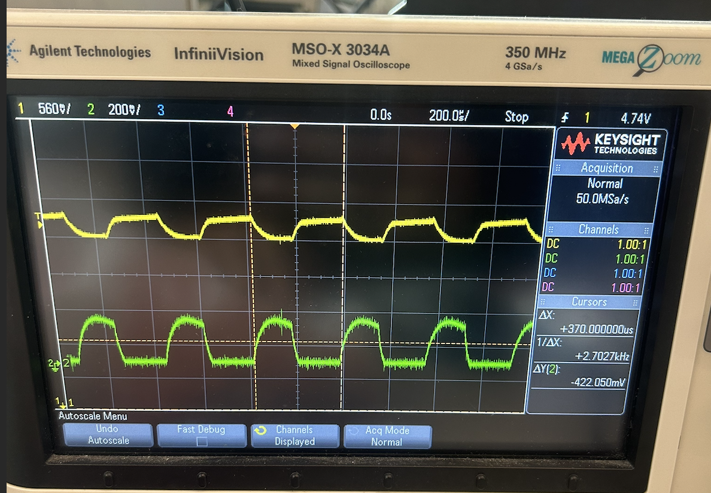

I2
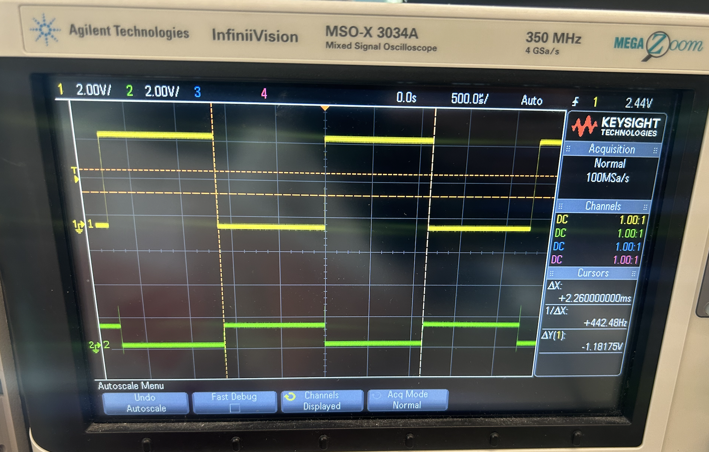

I3
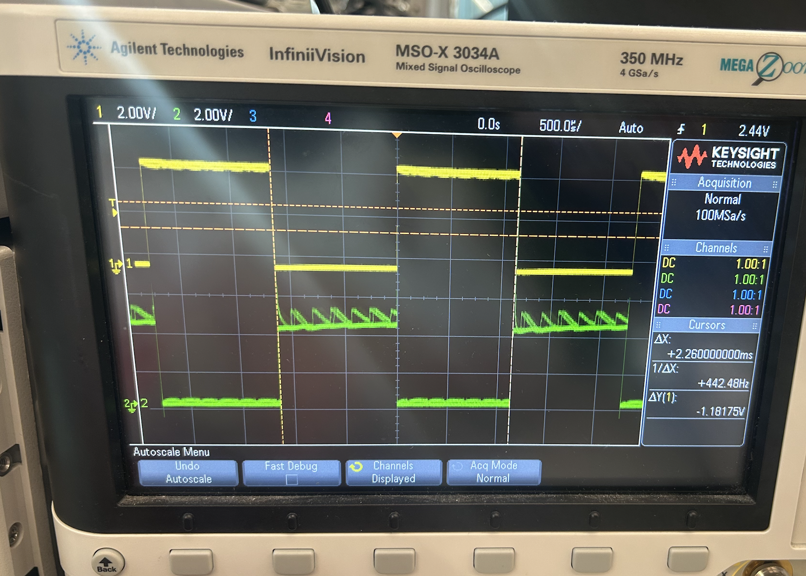

I4
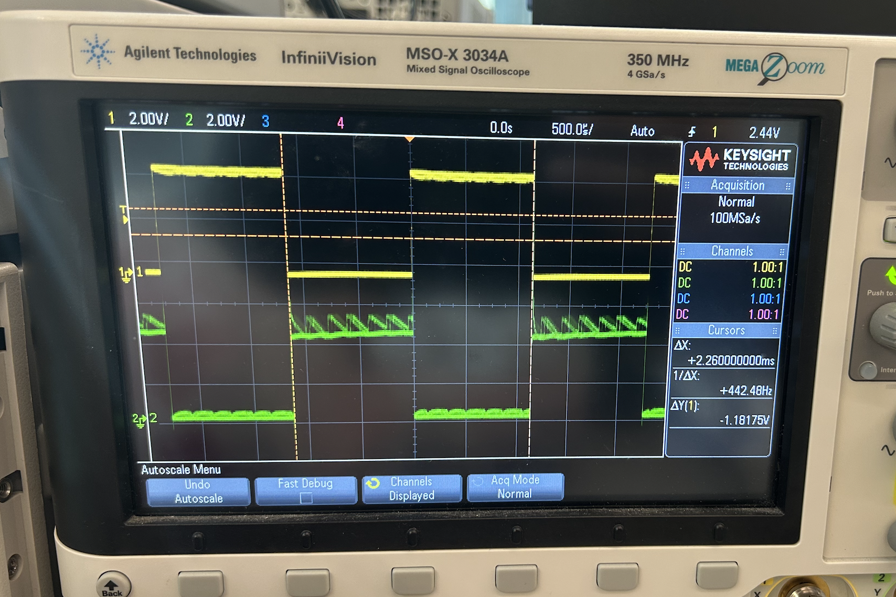

I5
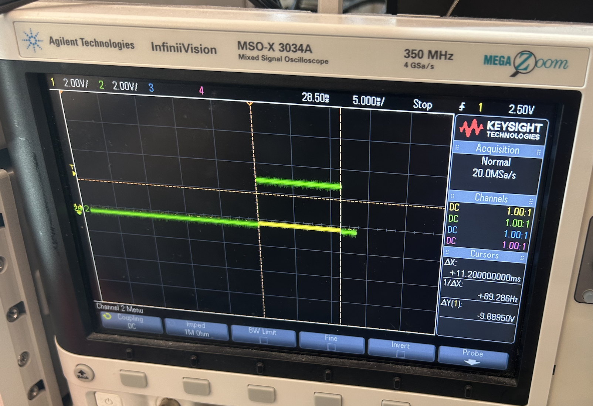

I6
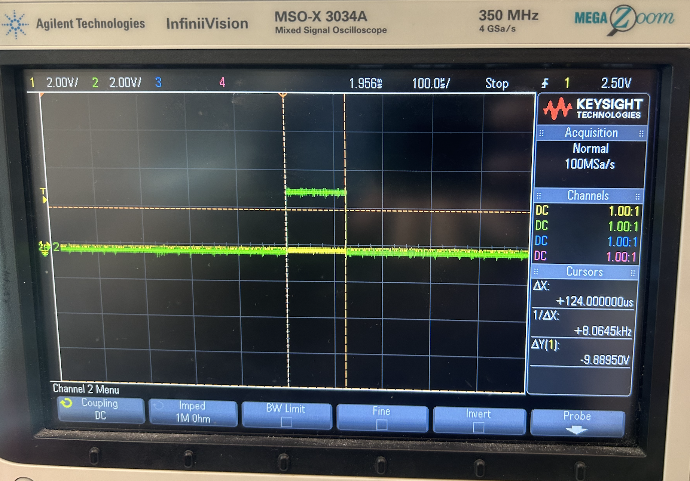

R1
| Note | Frequency (Hz) | OCR0A |
|------|---------------:|------:|
| C6   | 1046           | 60    |
| D6   | 1174           | 53    |
| E6   | 1318           | 47    |
| F6   | 1397           | 45    |
| G6   | 1568           | 40    |
| A6   | 1760           | 36    |
| B6   | 1975           | 32    |
| C7   | 2093           | 30    |

R2
OCR0A = 0.002709 * SENSOR_VALUE + 29.664

S2
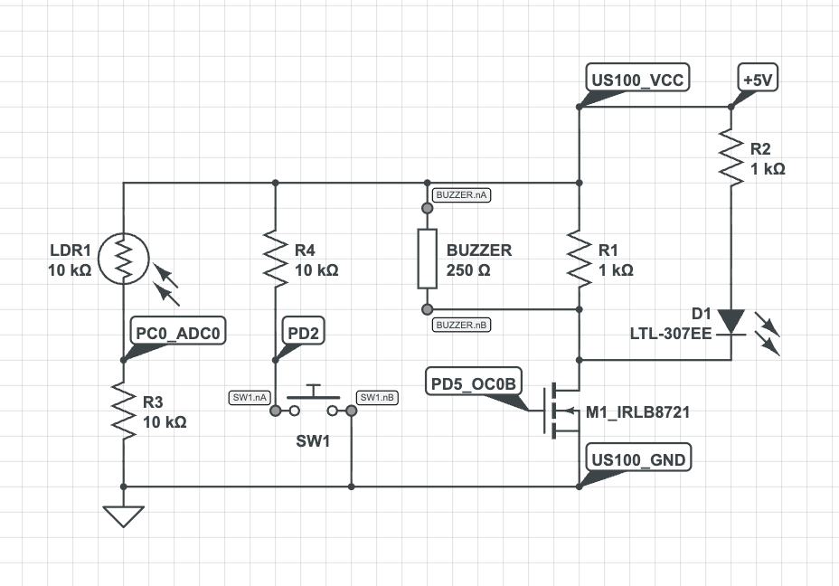

I7
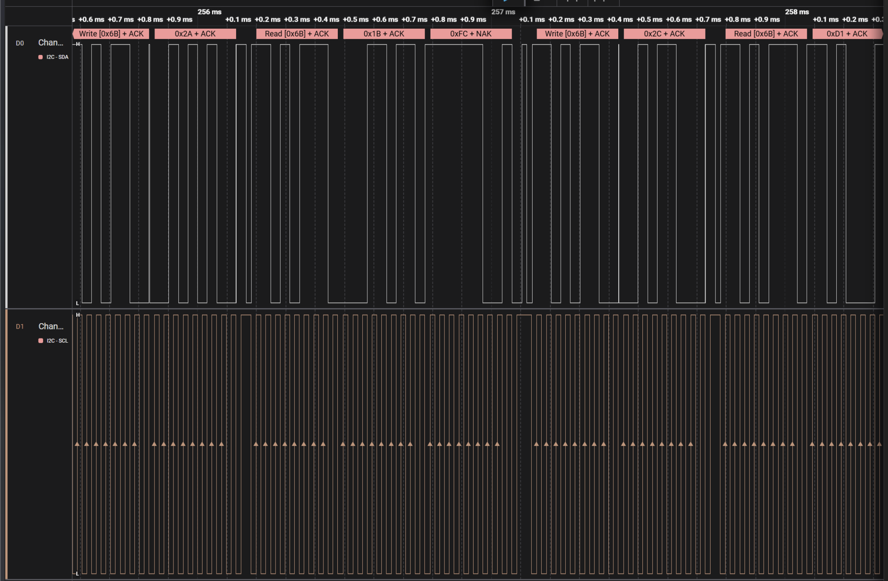

I8
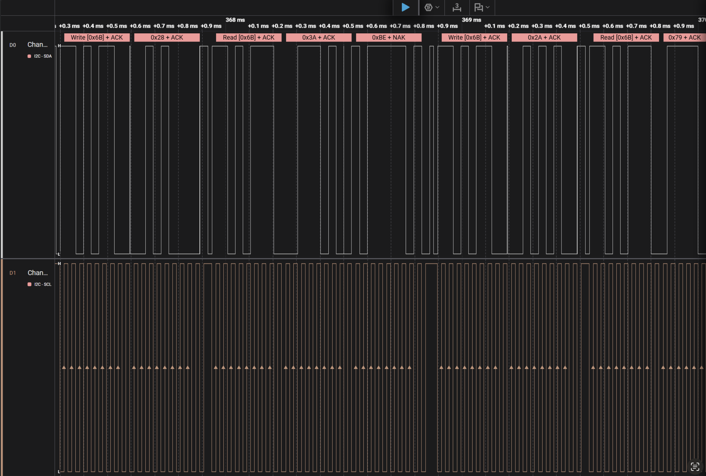

I9
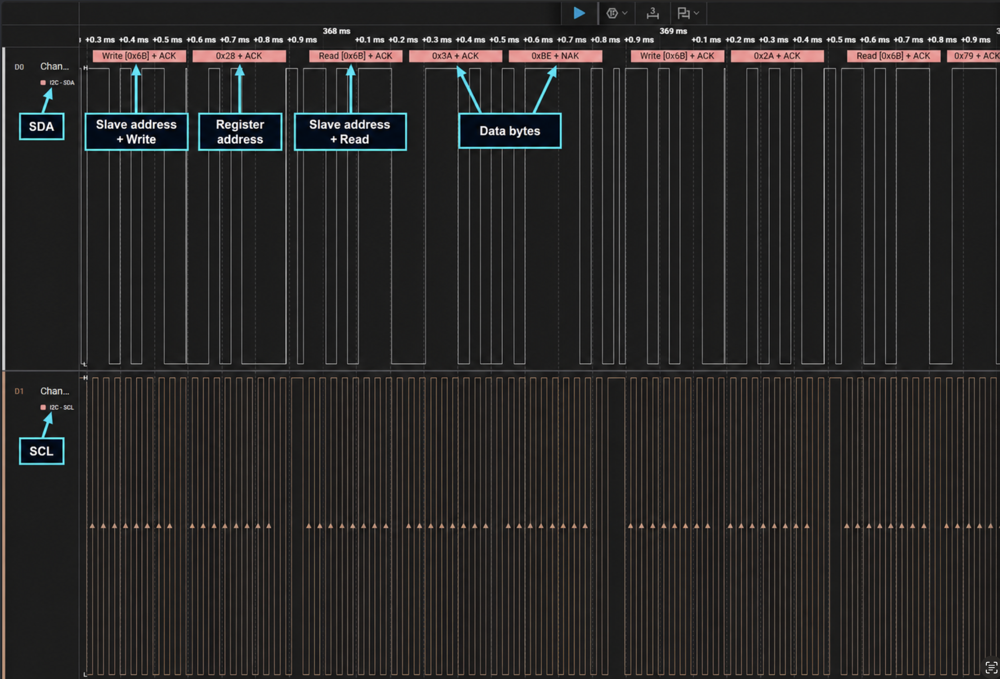

I10
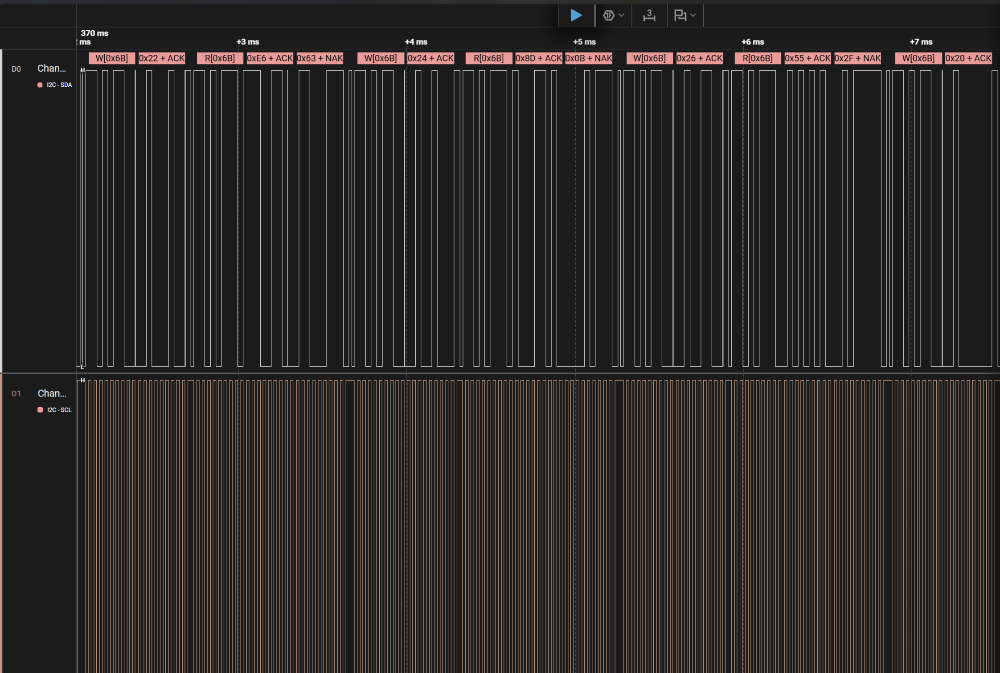